# Corpus-0mnia Forensics (C0F)

Portable **Linux live-response evidence collector**: one folder, one command, any distribution.
C0F ships its own trusted, statically linked toolkit (x86_64, aarch64, armv7), so it works on minimal,
old, new or damaged systems without trusting the programs installed on the server you examine.

*A real run on a small test server (2 minutes). Try it yourself in the browser: [docs/demo.html](docs/demo.html)
(download and open the file; type commands, answer the prompts, try wrong options).*

* 227 catalog items in 23 domains (system, time, memory, processes, network, firewall, accounts,
  persistence, services, software, filesystem, logs, web, databases, mail, applications, desktop/X11,
  containers, Kubernetes, virtualization, cloud agents, security tools, kernel/rootkit)
* RAM image (AVML), per-process memory, swap, packet capture, filesystem timeline + bodyfile, ext metadata image
* every file hashed (SHA-256 + MD5) with its original timestamps; chain-of-custody, failures and
  not-collected lists, tools-used list (kit vs. server programs)
* a failing command is reported and the run continues; disk space is protected (large items are skipped
  first, nothing is written below a hard floor)
* result: one AES-256 encrypted 7-Zip archive (file names encrypted)
* the kit verifies its own signature and every file at start; OS profiles report commands that should
  exist on that OS version but are missing

## Download and use

1. Download from **Releases**: `C0F-<version>.tar.gz`, `RELEASE-SHA256SUMS.txt`, `RELEASE-SHA256SUMS.txt.minisig`.
2. **Verify on your own workstation** before using it: see [VERIFY.md](VERIFY.md).
3. Copy the extracted `C0F-KIT/` folder to the server (USB disk or network share preferred) and run as root:

       sudo ./c0f                      # no /bin/sh on the host?  ./bin/x86_64/busybox sh ./c0f.sh

4. Read the warning screen and type `YES`. The archive, report and custody summary are written to
   `<kit folder>/<HOSTNAME>/` (or `--out DIR`). Default archive password: the short hostname
   (`--password-prompt` to choose one).

`./c0f --help` lists all options (`--no-ram`, `--no-pcap`, `--dry-run`, `--self-test`, ...).

## Documentation

| Document | Content |
|---|---|
| [docs/GUIDE.md](docs/GUIDE.md) | step by step with real input and output, the time-limit question, unattended runs, every error and warning with its fix, exit codes, **how long a run takes** for small to very large servers, disk space |
| [docs/REFERENCE.md](docs/REFERENCE.md) | everything C0F collects: all 227 items with command, kit tools, server programs used, output file and time limit; list of kit tools |
| [docs/DEMO.md](docs/DEMO.md) | full transcript of the demo run, plus the animated and the interactive demo |
| [VERIFY.md](VERIFY.md) | how to check that a kit or release is genuine (Linux and Windows) |
| `README.txt` in the kit | the complete manual: every item with purpose, expected output, meaning of an empty result, forensic value, impact on the system, references |

GUIDE, REFERENCE and VERIFY are also inside the kit (`docs/`), so they are available offline on the server.

**Authorized use only.** The output contains password hashes, keys, tokens and personal data.
Collection writes to the output disk and adds entries to system logs; prefer external media.

## Official release key

    RWTFlf0U9/S2PXk4OI50uQVSJDMd8eMj4fzXLKRv9IpU8ux5DvRQpr5p   (minisign, key id 3DB6F4F714FD95C5)

Anyone may build and sign their own copy (open license). Only this key identifies an official C0F release.

## Repository layout

| Path | Content |
|---|---|
| `kit-src/` | `c0f` launcher, `c0f.sh.in`, `lib-src/` (collection functions), `catalog/` (items), tools that generate `catalog.tsv`, `os-profile.tsv`, `README.txt`, `BUILDINFO.txt` |
| `helpers/` | C0F helper programs in C: `c0f-copy`, `c0f-logins`, `c0f-memdump`, `c0f-sshkey`, `c0f-x11`; glibc-layout utmp shim; tests |
| `build/`, `buildimg/`, `fetch.sh` | offline static build of the third-party tools (zig cc + musl) |
| `SHA256SUMS.sources`, `SHA256SUMS.official`, `sig/`, `keys/` | hashes, upstream signatures and keys of every input |
| `build/patches/` | the one C0F change to third-party code: BusyBox `ash` read builtin fix (see below) |
| `kit/` | assemble, sign and release scripts |
| `testruns/run-distros.sh` | runs the kit in containers of several distributions |
| `demo/` | scripts that record the demo runs and build `docs/demo.svg`, `docs/demo.html` and `docs/DEMO.md` |
| `docs/` | user guide, collection reference, demo |

## Build from source

Requires Linux with Docker. All builds run in an offline container.

    sh fetch.sh                                  # official sources, binaries, signatures (into src/, sig/, bin-official/)
    sha256sum -c SHA256SUMS.sources              # run inside src/ ; verify the upstream signatures in sig/ with keys/
    (cd bin-official && sha256sum -c ../SHA256SUMS.official)
    mkdir -p tools/zig && tar -xJf src/zig-x86_64-linux-0.17.1.tar.xz -C tools/zig --strip-components=1
    tar -xzf src/minisign-0.12-linux.tar.gz -C tools --exclude='._*'      # tools/minisign-linux/<arch>/minisign
    docker build -t c0f-build:1 buildimg
    sh build/run-all.sh                          # third-party tools for x86_64, aarch64, armv7 -> build/out/
    docker run --rm --network none -v "$PWD":/w c0f-build:1 sh /w/helpers/build-helpers.sh
    docker run --rm --network none -v "$PWD":/w c0f-build:1 sh /w/helpers/fix-chk-utmp.sh
    sh kit/assemble.sh && sh kit-src/tools/mkkit.sh
    sh kit/mksums.sh kit/C0F-KIT <your minisign secret key> "my build"   # your key: not an official release

Each release also publishes `C0F-<version>-third-party-sources.tar` with the exact upstream source
archives, signatures, build scripts and patches.

BusyBox 1.38.0 is built with one small patch (`build/patches/busybox-1.38.0-ash-read-after-trap.patch`):
after a trapped signal such as Ctrl+C, the unpatched `ash` `read` builtin loops forever with 100 % CPU,
which made an interrupted collection hang instead of archiving what it had collected.

## Licenses

C0F code: **MIT OR GPL-2.0-or-later** (your choice), see [LICENSE](LICENSE).
Third-party programs in the kit keep their own licenses (GPL, LGPL, BSD, MIT, Apache-2.0); texts in
`kit-src/LICENSES/`, list in `kit-src/VENDOR-BINARIES.txt` and section 12 of the kit `README.txt`.

---
*Decoding the shadows, sharing the light. Sharing Knowledge, Securing Truth. Contribute & Share Responsibly.*
